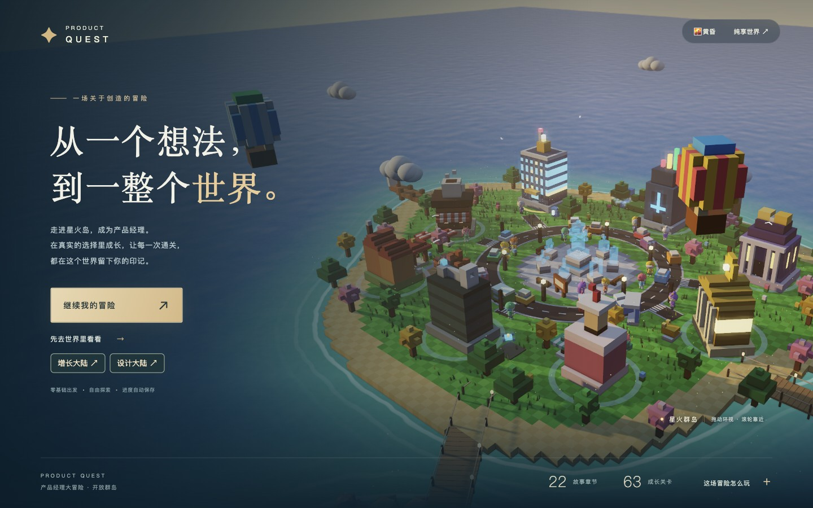
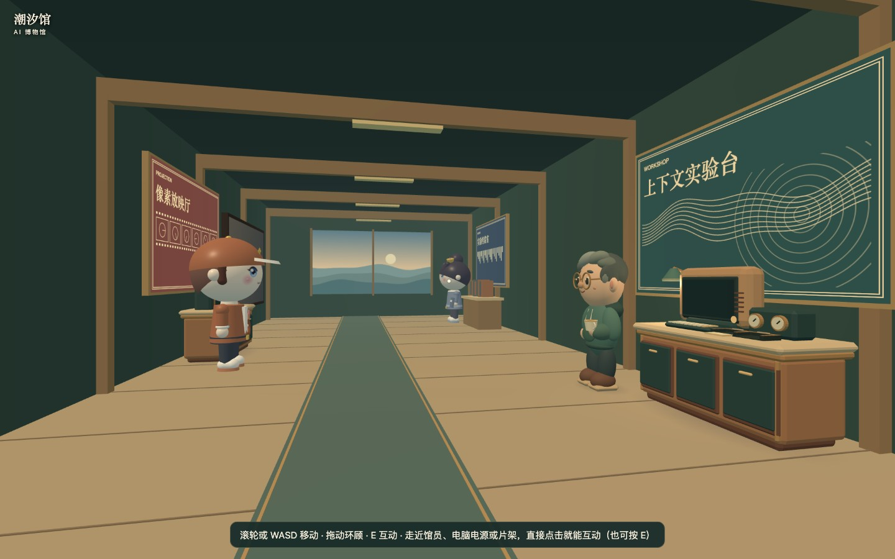
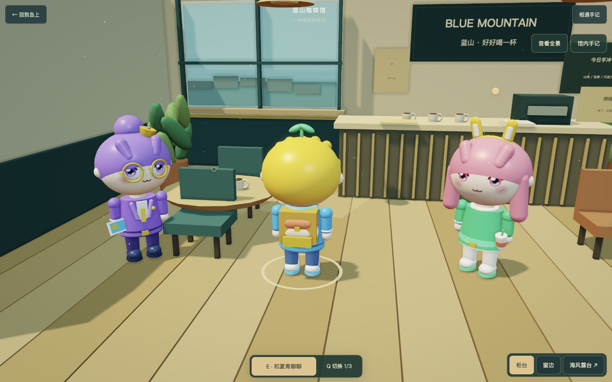
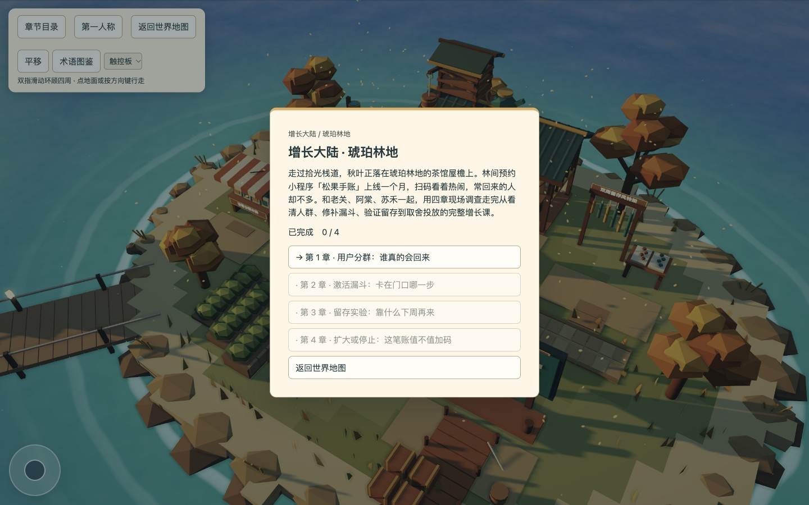
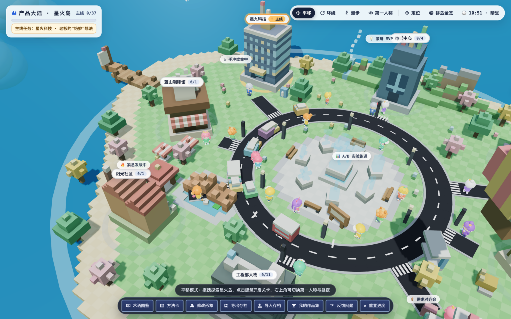

<div align="center">

# 产品经理大冒险 · Product Quest

**从一个想法，到一整个世界——在四块 3D 开放大陆与星潮 AI 博物馆里，用现场证据和动手实验学做产品。**

<p>
  <a href="https://nuts-and-bytes.github.io/Product-quest/"><strong>登岛试玩 ↗</strong></a> ·
  <a href="https://nuts-and-bytes.github.io/Product-quest/AI-Museum.html"><strong>走进星潮 AI 博物馆 ↗</strong></a> ·
  <a href="https://nuts-and-bytes.github.io/Product-quest/?experience=cafe-life">蓝山咖啡馆</a> ·
  <a href="CHANGELOG.md">更新日志</a> ·
  <a href="#english">English</a>
</p>

<br />



</div>

## 为什么做它

如果学做产品不是背框架、刷名词，而是推门走进一家遇到麻烦的咖啡馆，或者站在海边灯塔改建的 AI 博物馆里亲手搭实验台呢？

**Product Quest** 把产品思维、AI 实战、增长拆解与设计方法装进了四座相连的 3D 小岛。在这里没有标准答案的打分器——你可以先在街区里四处逛逛、和店员及常客聊天、翻看现场实物，再在预算与行动限制里挑出自己的方案，亲眼看店里的生意和人物反应如何随你的决定改变。

## 四块大陆与星潮 AI 博物馆

|  |  |
| :---: | :---: |
| *星潮 AI 博物馆（Tide Museum）：馆长石头、上下文实验台与像素放映厅* | *蓝山咖啡馆：自由走动、切换交互目标、翻看实物与海风露台* |

|  |  |
| :---: | :---: |
| *增长大陆 · 琥珀林地：林间茶馆的 4 章现场增长调查* | *星火群岛夜景：自由切换昼夜与视角，步行漫游四座小岛* |

### 当前可玩内容（22 故事章节 · 63 成长关卡）

| 区域 | 你可以体验什么 | 直达入口 |
| :--- | :--- | :---: |
| **产品大陆 · 星火岛** | 蓝山咖啡馆自由行走与排队调查、周末夜市摆摊副本、八章 90 天生存故事（含 3 个开放式天台结局），以及保留的 37 关经典 3D 室内练习（含数据法医机制） | [开放群岛 ↗](https://nuts-and-bytes.github.io/Product-quest/) |
| **AI 大陆 · 星潮观测站** | 5 章 18 关 AI 产品实战：从打破“全能聊天框”幻觉，到 RAG 语义切块、Golden Eval 与防提示词注入、Agent 物理权限闸门与大厂竞品突围 | [潮汐工坊 ↗](https://nuts-and-bytes.github.io/Product-quest/?experience=ai) |
| **星潮 AI 博物馆（Tide Museum）** | 独立第一人称 3D 常驻空间：和馆长「石头」在灯塔茶桌聊 AI 门道，翻看 2026 AI 编年史展签、上手上下文便签实验台、在像素放映厅看短片 | [走进博物馆 ↗](https://nuts-and-bytes.github.io/Product-quest/AI-Museum.html) |
| **增长大陆 · 琥珀林地** | 常驻林间茶馆街区 + 4 章现场调查：访客分群、首约激活漏斗、留存实验与渠道投放取舍 | [登岛调查 ↗](https://nuts-and-bytes.github.io/Product-quest/?experience=growth) |
| **设计大陆 · 珊瑚花园** | 常驻花房街区 + 4 章预约亭改造：现场观察、纸面原型、可用性测试与无障碍交付 | [登岛调查 ↗](https://nuts-and-bytes.github.io/Product-quest/?experience=design) |

> 电脑端支持 `WASD` / 方向键行走、`Shift` 奔跑、`Q` 切换附近目标、`E` 交互、`J` 手记、触控板双指环顾；手机端支持虚拟摇杆与横屏自适应，旋转不丢进度。

## 快速开始

纯静态运行，只需 Python 3；跑自动测试或打包单文件 HTML 需要 Node.js。

```bash
git clone https://github.com/nuts-and-bytes/Product-quest.git
cd Product-quest
python3 -m http.server 8765
```

浏览器打开 <http://localhost:8765/>（或直接访问 <http://localhost:8765/AI-Museum.html> 体验星潮 AI 博物馆）。

```bash
node --test tests/*.test.cjs        # 运行自动化测试套件
node scripts/build-single-html.mjs  # 打包离线单文件 dist/Product-Quest.html
```

<details>
<summary><strong>代码结构、存档与模拟边界</strong></summary>

<br />

- **核心目录**：
  - `engine.js`、`content/pm/`、`content/ai/`、`content/continent-courses.js`：引擎与四块大陆剧情、案例、术语和博物馆剧本
  - `assets/island3d.js`、`assets/world-map.js`、`assets/continent-settlements.js`：3D 开放群岛、常驻街区与视角可见性
  - `assets/tide-museum.js`、`assets/tide-films.js`、`AI-Museum.html`：第一人称星潮 AI 博物馆、便签实验台与放映厅
  - `docs/`：各玩法与交互系统的设计说明（[开放世界](docs/open-world.md) · [AI 大陆适配](docs/ai-presentation.md) · [蓝山调查](docs/cafe-case.md) · [室内行走](docs/cafe-walking.md) · [八章故事](docs/island-chapters.md) · [手机横屏](docs/mobile-play.md)）
- **存档与模拟边界**：
  - 所有进度保存在当前浏览器本地，跨设备或换域名迁移前请使用内置的导出/导入存档功能。
  - 咖啡馆排队、增长与 AI 实验均由确定性状态模型驱动，不接入联网 AI 打分，所有人物、店铺与经营数据为虚构教学情境。
  - 帧率随设备性能变化，可在游戏内「更多」切换画质档位。
- **反馈与许可**：问题或内容纠错欢迎提 [Issue](https://github.com/nuts-and-bytes/Product-quest/issues)。源码采用 MIT License，原创剧情与学习内容采用 CC BY-NC 4.0，详见 [LICENSE](LICENSE)。

</details>

## English

**Product Quest** is a browser-based 3D open-archipelago game for learning product, AI, growth, and design through field investigation rather than memorizing frameworks.

Explore four interconnected 3D islands—**Spark Island** (Blue Mountain Café investigation, weekend night market, an 8-chapter 90-day story, and 37 classic 3D lessons), **Star Tide Observatory** (5 chapters / 18 AI product levels plus the standalone first-person **Tide Museum** with an interactive workbench and pixel screenings), **Amber Grove** (4 growth investigation chapters), and **Coral Garden** (4 design chapters).

- [Play online ↗](https://nuts-and-bytes.github.io/Product-quest/) · [Enter the Tide Museum ↗](https://nuts-and-bytes.github.io/Product-quest/AI-Museum.html)
- Run locally: `python3 -m http.server 8765`, run tests with `node --test tests/*.test.cjs`, or build the standalone offline HTML with `node scripts/build-single-html.mjs`.

---

<p align="center">made by <a href="https://heystone.site/">stone</a> · 为 AI 世界留一点人味</p>
